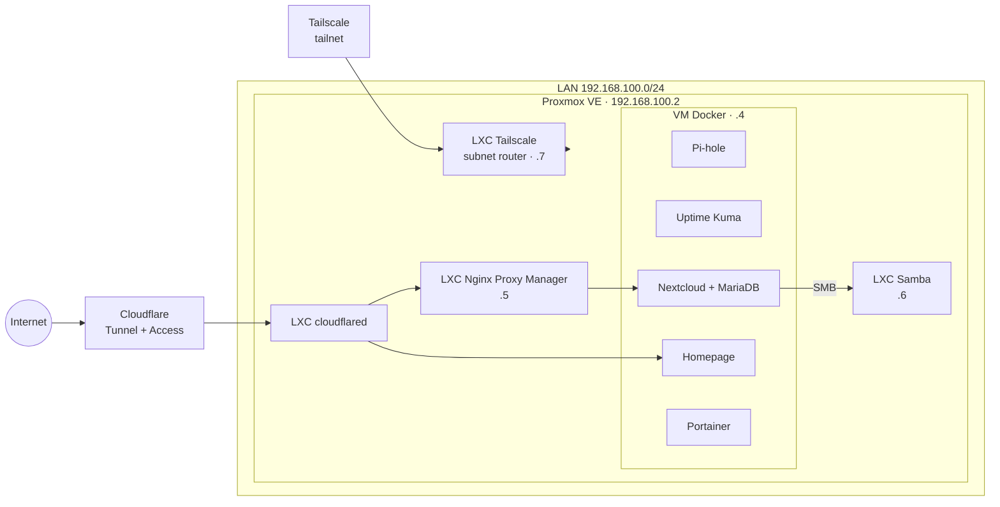

# Homelab

Laboratorio de infraestructura doméstico sobre **Proxmox VE**, operado como un entorno de servicios permanente. Lo uso para practicar virtualización, redes, contenedores y otras cosas. Además de documentar cómo se diseña, se despliega y se diagnostica cada componente.

> Es un entorno de laboratorio, no de producción. Las decisiones priorizan aprender y documentar con un presupuesto bajo, y cada una explica sus limitaciones.

---

## Arquitectura



**Dos caminos de entrada, con propósitos distintos:**

- **Cloudflare Tunnel + Cloudflare Access**: publica en Internet solo las aplicaciones web pensadas para uso diario (Nextcloud y Homepage). No hay puertos abiertos en el router, algo necesario porque la conexión está detrás de CGNAT, y cada acceso pasa antes por autenticación con Google.
- **Tailscale (subnet router)**: administración remota. Proxmox, SSH, Samba y los paneles de administración **no** se publican en Internet; se alcanzan por VPN como si estuviera en la LAN.

## Hardware

| Componente | Detalle |
|---|---|
| Equipo | Lenovo ThinkCentre M75q-1 (mini-PC) |
| CPU | AMD Ryzen 3 3300GE, 4 núcleos / 8 hilos, AMD-V |
| RAM | 24 GB DDR4-2666 |
| SSD 1 TB | Proxmox, VM y LXC — pool ZFS `rpool` (un solo disco) |
| HDD 2 TB | ext4 en `/mnt/storage`: ISOs, respaldos, plantillas y datos de usuario |

## Servicios

| Servicio | Plataforma | Función | Acceso |
|---|---|---|---|
| Pi-hole | VM Docker | DNS interno, filtrado, wildcard `*.lab` | LAN / Tailscale |
| Uptime Kuma | VM Docker | Monitoreo de disponibilidad | LAN / Tailscale |
| Portainer | VM Docker | Administración de Docker | LAN / Tailscale |
| Nextcloud + MariaDB | VM Docker | Almacenamiento y colaboración | Internet (Access) |
| Homepage | VM Docker | Panel de accesos | Internet (Access) |
| Nginx Proxy Manager | LXC | Reverse proxy por nombre de host | LAN / Tailscale |
| Samba | LXC | Recursos SMB para Windows y Nextcloud | LAN / Tailscale |
| cloudflared | LXC sin privilegios | Conector del túnel de Cloudflare | — |
| Tailscale | LXC sin privilegios | VPN y subnet router de la LAN | — |

## Decisiones de diseño

- **Docker dentro de una VM, no en el host.** El hipervisor queda limpio y la VM se puede respaldar, restaurar o reemplazar como una unidad.
- **Servicios de borde en LXC separados** (proxy, túnel, VPN). Siguen funcionando aunque la VM de aplicaciones se reinicie.
- **Cloudflare Tunnel en lugar de abrir puertos.** Funciona bajo CGNAT, no expone la IP del hogar y permite poner autenticación delante con Cloudflare Access.
- **Tailscale para administrar, no el túnel.** Las interfaces de administración nunca quedan publicadas en Internet.
- **SSD para cargas activas, HDD para datos y respaldos.** El SSD queda reservado para lo que necesita baja latencia.

## Troubleshooting

Casos reales encontrados durante el montaje, documentados como problema → diagnóstico → causa → solución.

- [Docker no puede montar overlay dentro de un LXC](docs/troubleshooting/docker-overlay-en-lxc.md)

## Roadmap

**Hecho**
- [x] Proxmox VE con ZFS (compresión LZ4, autotrim) e HDD integrado como almacenamiento
- [x] VM Docker con Pi-hole, Uptime Kuma, Portainer, Nextcloud y Homepage
- [x] Reverse proxy con resolución wildcard en Pi-hole
- [x] Acceso remoto: Cloudflare Tunnel + Access y Tailscale con subnet routing

**Siguiente**
- [ ] Respaldos de todos los LXC con política de retención
- [ ] Copia de los datos de usuario fuera del HDD y prueba de restauración
- [ ] Alertas en Uptime Kuma en Telegram
- [ ] Laboratorios de redes con Containerlab

## Estructura del repositorio

```
.
├── README.md
├── docs/
│   └── troubleshooting/   # casos documentados + plantilla
└── services/              # (en construcción) un directorio por servicio
```

> Credenciales, tokens y archivos `.env` no se versionan. Cada servicio incluirá un `.env.example` con las variables necesarias.
