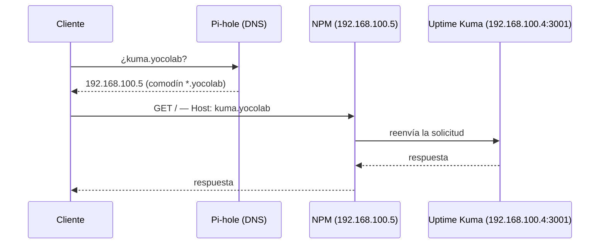

# Nginx Proxy Manager

Reverse proxy del laboratorio. Recibe todas las solicitudes HTTP y HTTPS dirigidas a nombres internos y las reenvía al servicio correspondiente según el nombre de host. Así se accede a `kuma.yocolab` en lugar de `192.168.100.4:3001`.

| | |
|---|---|
| **Plataforma** | LXC Debian **privilegiado** con *nesting*, con Docker dentro |
| **IP** | `192.168.100.5` |
| **Recursos** | 1 vCPU · 1 GB RAM · 25 GB de disco |
| **Puertos** | `80` (HTTP) · `443` (HTTPS) · `81` (administración) |
| **Persistencia** | `/opt/docker/nginx-proxy-manager/{data,letsencrypt}` |

## Por qué un LXC separado

El proxy es la puerta de entrada a todos los servicios web, incluido el tráfico que llega desde Internet por el túnel de Cloudflare. Si estuviera en la VM Docker, un reinicio de esa VM cortaría el acceso a todo. En un LXC propio funciona con independencia de la VM de aplicaciones y consume menos recursos que una VM.

## Cómo funciona el acceso por nombre

Para que `http://kuma.yocolab` funcione tienen que intervenir dos componentes:



1. **DNS:** Pi-hole responde la IP **del proxy**, no la del servicio. Un registro comodín (`address=/*.yocolab/192.168.100.5`) hace que cualquier nombre `.yocolab` apunte al proxy ([guía de Pi-hole](../pihole/README.md#4-registros-dns-locales)).
2. **Proxy:** NPM lee el encabezado `Host` de la solicitud y la reenvía al destino configurado para ese nombre.

Sin el paso 1, el proxy puede estar bien configurado y aun así el navegador responde que el servidor no existe: el nombre nunca llega al proxy. Eso pasó en el primer proxy host, antes de crear el registro DNS.

## Despliegue

### 1. Crear el LXC

Desde **Crear CT** en Proxmox, con una plantilla Debian:

| Parámetro | Valor | Motivo |
|---|---|---|
| Contenedor sin privilegios | **Desmarcado** (privilegiado) | Docker dentro del LXC lo necesitó en este despliegue (ver [Limitaciones](#limitaciones)) |
| CPU / RAM | 1 vCPU / 1 GB | NPM es liviano |
| Disco | 8 GB inicial → **25 GB** | Con el storage driver `vfs` no alcanzan 8 GB ([caso](../../docs/troubleshooting/docker-overlay-en-lxc.md)) |
| Red | `vmbr0`, IP fija `192.168.100.5/24` | Los registros DNS apuntan a esta IP; no puede cambiar |

Después se activa la opción **Nesting** en *Opciones → Características*. Permite ejecutar contenedores dentro del LXC.

> Activar *Nesting* en un contenedor privilegiado requiere iniciar sesión como `root@pam`. Con otro usuario, Proxmox devuelve un error de permisos.

### 2. Instalar Docker

```bash
pct enter <CTID>
apt update && apt full-upgrade -y
apt install -y curl
curl -fsSL https://get.docker.com | sh
```

La plantilla de Debian es mínima y no incluye `curl`. El script oficial de Docker configura el repositorio, importa la clave de firma e instala Docker Engine y Compose.

Si los comandos muestran advertencias de *locale* (`Setting locale failed`), hay que generar uno válido:

```bash
apt install -y locales
sed -i 's/^# *en_US.UTF-8/en_US.UTF-8/' /etc/locale.gen
locale-gen
update-locale LANG=en_US.UTF-8
```

### 3. Configurar el storage driver

Dentro de este LXC, Docker no puede usar `overlay2`. Se fuerza `vfs` antes del primer despliegue:

```bash
echo '{ "storage-driver": "vfs" }' > /etc/docker/daemon.json
systemctl restart docker
docker info | grep "Storage Driver"     # → vfs
```

El diagnóstico completo y sus consecuencias están en el [caso de troubleshooting](../../docs/troubleshooting/docker-overlay-en-lxc.md).

### 4. Desplegar NPM

```bash
mkdir -p /opt/docker/nginx-proxy-manager/{data,letsencrypt}
cd /opt/docker/nginx-proxy-manager
# copiar compose.yaml
docker compose up -d
docker compose ps
```

- **`data/`**: base de datos de NPM, proxy hosts, usuarios y la configuración de Nginx generada.
- **`letsencrypt/`**: certificados y sus claves privadas. **No se versiona.**

### 5. Primer acceso

Abre `http://192.168.100.5:81`. Las versiones recientes piden crear la cuenta de administrador en el primer ingreso; ya no hay credenciales por defecto.

## Proxy hosts

Hay dos tipos de nombre:

- **`.yocolab`**: servicios de administración, solo accesibles desde la LAN o por Tailscale. Los resuelve Pi-hole.
- **`.yocolab.dev`**: servicios publicados en Internet por el túnel de Cloudflare, sobre el dominio público.

| Nombre | Destino | Opciones |
|---|---|---|
| `kuma.yocolab` | `http://192.168.100.4:3001` | Websockets Support, Block Common Exploits |
| `npm.yocolab` | `http://192.168.100.5:81` | — |
| `pihole.yocolab` | `http://192.168.100.4:8081` | Redirección de `/` a `/admin` |
| `portainer.yocolab` | `https://192.168.100.4:9443` | Esquema HTTPS hacia el backend |
| `nextcloud.yocolab.dev` | `http://192.168.100.4:8082` | Sin SSL en NPM: el TLS termina en Cloudflare |
| `home.yocolab.dev` | `http://192.168.100.4:3000` | — |

Todos los hosts están en **HTTP Only** y con acceso **Public**, es decir, sin listas de acceso de NPM.

Detalles de configuración:

- **Websockets (Uptime Kuma):** el panel actualiza los monitores en tiempo real por WebSockets. Sin esta opción carga, pero no se actualiza.
- **Esquema HTTPS (Portainer):** el puerto 9443 solo acepta conexiones cifradas, con su propio certificado autofirmado. NPM se conecta al backend por HTTPS aunque el cliente use HTTP.
- **Nextcloud sin SSL en NPM:** el certificado público lo emite y presenta Cloudflare. El túnel entrega el tráfico a NPM por HTTP, así que en este proxy host **no** se activa *Force SSL*: NPM redirigiría a `https://`, Cloudflare volvería a entregar la solicitud por HTTP y se formaría un bucle de redirecciones. Del lado de Nextcloud, `overwriteprotocol = https` hace que genere sus enlaces con `https://`.
- **Redirección de Pi-hole:** el panel vive en `/admin`, así que abrir `pihole.yocolab` sin ruta no lleva a ninguna parte. En *Advanced → Custom Nginx Configuration*:

  ```nginx
  location = / {
      return 301 /admin;
  }
  ```

  Por el modificador `=`, la regla solo afecta a la ruta exacta `/`; el resto de las rutas se reenvía normalmente.

## Relación con el túnel de Cloudflare

El tráfico de Internet hacia `nextcloud.yocolab.dev` entra por el túnel y llega a NPM en `http://192.168.100.5:80`. NPM lo enruta por el encabezado `Host`, igual que el tráfico interno. Por eso los servicios publicados necesitan un nombre `.yocolab.dev` en su proxy host: tiene que coincidir con el nombre que llega desde Cloudflare.

Al principio los nombres internos eran `.lab`, y después pasaron a `.yocolab`. Cuando se publicaron servicios por el túnel, Uptime Kuma, NPM y Pi-hole también tuvieron nombres `.yocolab.dev`. Esos nombres se retiraron al sacar los paneles de administración del túnel, y hoy solo los servicios publicados usan el dominio público.

El certificado público lo gestiona Cloudflare en su borde. El tramo entre `cloudflared` y NPM viaja por HTTP dentro de la LAN.

> `home.yocolab.dev` no sigue este camino: la ruta del túnel apunta directo a Homepage (`192.168.100.4:3000`), así que su proxy host en NPM no participa en el acceso externo.

## Verificación

```bash
# Desde un cliente que usa Pi-hole como DNS
curl -I http://kuma.yocolab          # → 200 desde Uptime Kuma
curl -I http://pihole.yocolab        # → 301 hacia /admin
```

En el panel de NPM, cada proxy host debe aparecer **Online**.

## Actualización

```bash
cd /opt/docker/nginx-proxy-manager
docker compose pull
docker compose up -d
```

Con `vfs`, cada imagen nueva ocupa varias veces su tamaño normal. Antes de actualizar, revisa el espacio con `df -h /` y borra las imágenes viejas con `docker image prune`.

## Problemas conocidos

- [Docker no puede montar overlay dentro de un LXC](../../docs/troubleshooting/docker-overlay-en-lxc.md): por qué este LXC usa `vfs` y necesita 25 GB de disco.

## Limitaciones

- **LXC privilegiado expuesto:** este contenedor recibe el tráfico que entra desde Internet por el túnel. Un contenedor privilegiado comparte el root con el host, así que un compromiso de NPM tendría más impacto que en un LXC sin privilegios.
- **Storage driver `vfs`:** desperdicia espacio (25 GB para un servicio liviano) y es lento al crear contenedores.
- **Criterio mixto en el túnel:** Nextcloud pasa por NPM y Homepage va directo.
- **Tramo interno sin cifrar:** entre `cloudflared` y NPM, y entre NPM y los servicios, el tráfico viaja por HTTP dentro de la LAN. Es aceptable en una red doméstica, pero cualquiera con acceso a la LAN podría verlo.
- La imagen usa `latest`.

## Pendiente

- [ ] **Sacar NPM de un LXC privilegiado con `vfs`.** Opciones evaluadas en el [caso de overlay](../../docs/troubleshooting/docker-overlay-en-lxc.md#pendiente): un LXC sin privilegios con `overlay2` (hipótesis por probar), `fuse-overlayfs`, o moverlo a la VM Docker.
- [ ] Unificar el criterio de las rutas del túnel: todas por NPM o todas directas.
- [ ] Monitor en Uptime Kuma para NPM.
- [ ] Fijar la versión de la imagen.
